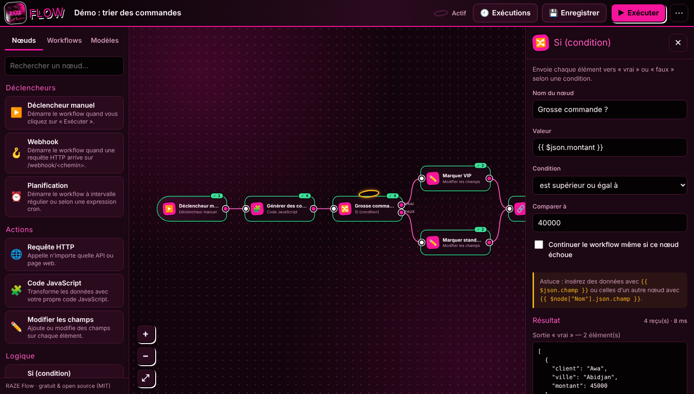

<p align="center">
  
</p>

<h1 align="center">RAZE Flow</h1>

<p align="center">
  <b>Automatisez vos tâches en reliant des nœuds.</b><br>
  Une alternative légère à n8n — 100 % gratuite, open source (MIT), auto-hébergée.
</p>

<p align="center">
  
</p>

## Pourquoi RAZE Flow ?

- **Gratuit, sans limite** : pas de compte, pas d'abonnement, pas de quota d'exécutions.
- **Application Windows** prête à installer, ou serveur à héberger soi-même.
- **Léger** : Node.js + 2 dépendances. Pas de base de données, pas d'étape de build. Tourne sur un petit VPS, un Raspberry Pi ou un téléphone (Termux).
- **Éditeur visuel** : glisser, relier, exécuter. Fonctionne à la souris **et au doigt** sur mobile.
- **Vos données restent chez vous** : tout est stocké en fichiers JSON dans `data/`.
- **Interface en français.**

## Fonctionnalités

| | |
|---|---|
| **Déclencheurs** | Manuel · Webhook (`/webhook/<chemin>`) · Planification (intervalle ou cron) |
| **Actions** | Requête HTTP · Code JavaScript · Modifier les champs |
| **Logique** | Si (vrai/faux) · Filtrer · Fusionner · Attendre · Séparer une liste · Regrouper · Limiter · Trier · Supprimer les doublons · Arrêter avec une erreur |
| **Intégrations** | IA (Ollama, OpenRouter, Groq, OpenAI…) · Telegram · Discord · Slack · E-mail SMTP · RSS · Lire/Écrire un fichier · Commande système |
| **Éditeur** | Historique des exécutions · résultat de chaque nœud · import/export JSON · modèles prêts à l'emploi · « continuer si erreur » |

Grâce aux nœuds **Requête HTTP** et **Code JavaScript**, vous pouvez brancher n'importe quel service qui possède une API.

## Installation

### Application Windows

Téléchargez l'installateur depuis la page [**Releases**](https://github.com/ck526438-lgtm/raze-flow/releases/latest) :

- `RAZE-Flow-Setup-x.y.z.exe` — installateur classique (raccourci sur le bureau) ;
- `RAZE-Flow-Portable-x.y.z.exe` — version portable, sans installation.

L'application s'ouvre dans sa propre fenêtre. Quand vous la fermez, elle reste dans la zone de notification (près de l'horloge) pour que vos webhooks et planifications continuent ; un clic droit sur l'icône permet de la lancer au démarrage de Windows ou de la quitter. Vos données sont dans `%APPDATA%\RAZE Flow\data`.

> L'exécutable n'est pas signé : au premier lancement, Windows SmartScreen affiche un avertissement. Cliquez sur « Informations complémentaires » puis « Exécuter quand même ».

Pour construire l'application vous-même : `npm install` puis `npm run dist:win` (sous Windows).

### Depuis le code source

Il faut [Node.js](https://nodejs.org) 20 ou plus récent.

```bash
git clone https://github.com/ck526438-lgtm/raze-flow.git
cd raze-flow
npm install
npm start
```

Ouvrez ensuite **http://localhost:5678**. Un workflow de démonstration vous attend : cliquez sur **Exécuter**.

### Avec Docker

```bash
docker compose up -d
```

Pensez à changer `RAZE_PASSWORD` dans `docker-compose.yml` avant de démarrer.

### Sur Android (Termux)

```bash
pkg install nodejs git
git clone https://github.com/ck526438-lgtm/raze-flow.git && cd raze-flow
npm install && npm start
```

## Configuration

Tout passe par des variables d'environnement (voir [`.env.example`](.env.example)) :

| Variable | Défaut | Rôle |
|---|---|---|
| `PORT` | `5678` | Port du serveur |
| `HOST` | `127.0.0.1` | `0.0.0.0` pour ouvrir l'accès au réseau |
| `RAZE_USER` / `RAZE_PASSWORD` | – | Protège l'éditeur et l'API par mot de passe |
| `RAZE_DATA_DIR` | `./data` | Dossier des workflows, de l'historique et des fichiers |
| `RAZE_MAX_EXECUTIONS` | `200` | Taille de l'historique |
| `RAZE_ALLOW_EXEC` | – | `true` pour autoriser le nœud « Commande système » |
| `TZ` | fuseau du serveur | Fuseau horaire des planifications cron (ex. `Africa/Abidjan`) |

```bash
cp .env.example .env
node --env-file=.env src/server.js
```

## Les expressions

Dans n'importe quel champ, insérez des données avec `{{ … }}` (du JavaScript) :

| Expression | Donne |
|---|---|
| `{{ $json.email }}` | Le champ `email` de l'élément en cours |
| `{{ $json.prix * 1.18 }}` | Un calcul |
| `{{ $node["Requête HTTP"].json.data.id }}` | Le résultat d'un autre nœud |
| `{{ $env.TELEGRAM_TOKEN }}` | Une variable d'environnement (pour vos secrets) |
| `{{ $now.toISOString() }}` | La date du moment |
| `{{ $items.length }}` | Le nombre d'éléments reçus |

Chaque nœud reçoit une liste d'**éléments** (des objets JSON) et en renvoie une autre. Un nœud qui ne reçoit aucun élément est ignoré : c'est ce qui permet les branches « vrai / faux ».

## Webhooks

1. Ajoutez un nœud **Webhook**, choisissez un chemin (ex. `contact`).
2. Activez le workflow (l'auréole **Actif** s'allume).
3. Appelez-le :

```bash
curl -X POST http://localhost:5678/webhook/contact \
  -H "Content-Type: application/json" \
  -d '{"nom": "Awa", "message": "Bonjour"}'
```

La réponse est le résultat du dernier nœud exécuté (ou immédiate, selon le réglage du nœud).

## Créer votre propre nœud

Ajoutez un objet dans `src/nodes/integrations.js` — l'interface génère le formulaire toute seule :

```js
{
  type: 'majuscules', label: 'Mettre en majuscules', group: 'core', icon: '🔠',
  description: 'Passe un texte en majuscules.',
  outputs: ['sortie'],
  fields: [{ name: 'texte', label: 'Texte', type: 'string', default: '{{ $json.nom }}' }],
  run: perItem((item, p) => ({ ...item, resultat: String(p.texte).toUpperCase() })),
}
```

Types de champs : `string`, `text`, `number`, `password`, `boolean`, `select`, `keyvalue`, `code`.

## Sécurité

RAZE Flow exécute du code et appelle des services en votre nom. Comme n8n, il est fait pour être **auto-hébergé par des personnes de confiance** :

- Par défaut le serveur n'écoute que sur `127.0.0.1`.
- Avant de l'exposer sur Internet : définissez `RAZE_USER` / `RAZE_PASSWORD` et placez-le derrière HTTPS (Caddy, Nginx, Cloudflare Tunnel…).
- Les URL `/webhook/…` sont publiques par nature : utilisez des chemins difficiles à deviner.
- Le nœud « Code » n'est pas un bac à sable de sécurité : ne collez que du code de confiance.
- Stockez vos secrets dans des variables d'environnement (`{{ $env.NOM }}`) plutôt que dans les workflows que vous partagez.

## Tests

```bash
npm test
```

## Limites connues et suite

- Pas de boucles dans le graphe (utilisez le nœud Code pour itérer).
- Un seul utilisateur (pas de gestion d'équipes).
- Pas encore de coffre d'identifiants chiffré, ni d'OAuth (Google Sheets, Gmail…).

Les contributions sont les bienvenues : ouvrez une *issue* ou une *pull request*.

## Licence

Code sous licence [MIT](LICENSE). Le logo RAZE est un élément de marque : il n'est pas couvert par la licence MIT.
